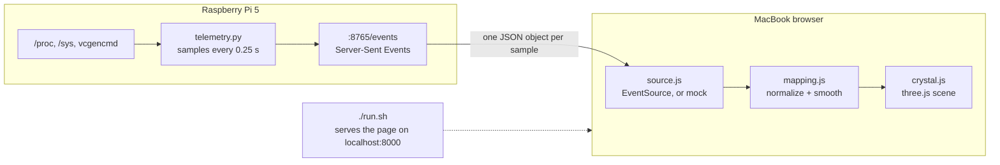

# Pi Crystal

A three.js crystal that breathes with a Raspberry Pi 5. The Pi streams its own readings
(temperature, load on each CPU core, fan speed, WiFi signal, memory, throttling) and the browser
on the Mac turns them into light and motion. No wiring is needed: the data comes from the Pi
itself. Buttons and sensors can join the same stream later.

## How the data flows



`telemetry.py` uses the Python standard library only, so nothing is installed on the Pi. One thread
reads the Pi and every connected browser gets the latest sample. The stream is read-only and its
CORS header only allows the page's origin (`http://localhost:8000`, `http://127.0.0.1:8000`).

## What drives what

| Reading | Source on the Pi | In the crystal |
|---|---|---|
| CPU temperature | `/sys/class/thermal/thermal_zone0/temp` | Core colour and the light through the glass: cyan ≤ 40 °C, amber around 62 °C, red ≥ 85 °C. Bloom grows with heat. |
| Total load | `/proc/stat` (deltas) | Breathing: how far and how fast the 80 facets drift apart. Also the camera's orbit speed. |
| Load per core (4) | `/proc/stat` (deltas) | The 4 shards around the core: size, glow, spin. |
| Fan | `/sys/devices/platform/cooling_fan/hwmon/*/fan1_input` | Spin of the three orbit rings (they drift slowly even with the fan off). |
| WiFi link quality | `/proc/net/wireless` (`wlan0`) | How much of the dust field sparkles. |
| Memory used | `/proc/meminfo` | Haze density. |
| Throttling now | `vcgencmd get_throttled` | A red flicker over everything. The "has occurred" bits are ignored. |

A reading the Pi can't provide is sent as `null`, and that channel settles at a neutral value.

## Run it

**Without the Pi** (mock data, with a stress burst every 45 s):

```sh
./run.sh                                     # from the repo root
open 'http://localhost:8000/pi-crystal/?source=mock'
open 'http://localhost:8000/pi-crystal/?source=mock&at=32'   # start at the burst
```

**With the Pi.** It must be on the same WiFi as the Mac. Set up SSH key login first, or ssh asks
for the password (pi-lab: `scripts/pi key`).

```sh
./run.sh pi-deploy                           # copy telemetry.py to ~/pi-crystal/ on the Pi
./run.sh pi-serve                            # run it there; the live status line shows in this terminal
./run.sh                                     # second terminal: serve the page
open http://localhost:8000/pi-crystal/
```

`PI_HOST` (default `raspberrypi.local`) and `PI_USER` (default `pieter`) pick the Pi.
`?pi=host:port` points the page at a different one. Make it work hard to see it react:

```sh
ssh "$PI_USER@$PI_HOST" 'for i in 1 2 3 4; do timeout 30 yes > /dev/null & done; wait'
```

The badge in the corner says where the data comes from:

| Badge | Meaning |
|---|---|
| `live · Pi` | samples arrived in the last 2.5 s |
| `Pi not reachable · mock` | no sample ever arrived; it keeps retrying |
| `reconnecting · mock` | it was live, then stopped |
| `mock data` | `?source=mock` |

## Files

| File | Role |
|---|---|
| `index.html` | Page, HUD, import map (`three` → `../vendor/three/`) |
| `main.js` | Renderer, camera, bloom, HUD, frame loop |
| `crystal.js` | The scene objects and `update(channels, time, dt)` |
| `mapping.js` | Pure functions: readings → 0..1 channels, smoothing, colours, the mock Pi |
| `source.js` | Live/mock switch around `EventSource` |
| `pi/telemetry.py` | The server that runs on the Pi |
| `pi/test_telemetry.py`, `tests/*.test.mjs` | Tests (run by `../test.sh`) |
| `package.json` | Only `"type": "module"`, so node can check and test these files. No dependencies. |
